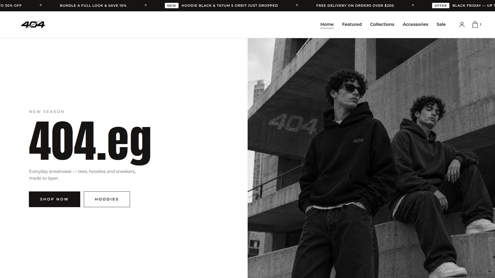

<p align="center">
  A contemporary streetwear shopping experience featuring distinctive collections, bold aesthetics, and a unique brand identity.
</p>

[](https://github.com/readme-SVG/animated-line)

## 01. Overview

**404.eg** is a fictional streetwear brand concept built around a bold visual identity and a modern digital shopping experience.

Inspired by contemporary streetwear culture, the project brings together distinctive product collections, minimalist aesthetics, and an intuitive shopping interface to create a cohesive brand experience.

From product discovery to the shopping journey, every element is designed to reflect the identity and character of 404.

## 02. Features

- **Modern Storefront** — Streetwear-inspired landing page and shopping interface.
- **Product Catalog** — Organized product listings and collections.
- **Product Gallery** — Interactive product image presentation.
- **Shopping Cart** — Frontend cart interactions.
- **Search & Navigation** — Product discovery and intuitive navigation.
- **Checkout Interface** — Demonstration of the checkout experience.
- **Responsive Design** — Layouts adapted for desktop and mobile screens.
- **Interactive UI** — Dynamic elements and interface feedback.

## 03. Tech Stack


| Technology | Purpose |
|:---|:---|
| HTML5 | Structure and semantic markup |
| CSS3 | Styling and responsive layouts |
| Vanilla JavaScript | Frontend functionality and interactions |
| Git & GitHub | Version control and source management |
| Vercel | Hosting and deployment |

## 04. Project Structure

```text
404.eg/
│
├── index.html
│
├── css/
│   └── style.css
│
├── js/
│   └── main.js
│
└── assets/
    ├── Logo.png
    └── Banner.png
```

## 05. Visual Assets & Credits

The visual materials used in this project come from multiple sources:

- **AI-Generated Images** — Visual assets created using AI tools.
- **Pinterest References** — Selected images sourced from Pinterest for visual inspiration and design purposes.

Third-party assets remain the property of their respective owners.

## 06. Demo Disclaimer

<sub>IMPORTANT — DEMONSTRATION PROJECT ONLY</sub>

**404.eg is a fictional brand concept and a non-commercial frontend showcase. It is not a real business, operational online store, or officially established clothing brand.**

This project was developed exclusively for portfolio and educational demonstration purposes.

- All products, prices, and product listings are fictional.
- Shopping cart and checkout features are provided for demonstration only.
- No real purchases, orders, or financial transactions can be made.
- No actual payment processing or commercial order fulfillment is available.
- The website does not represent an operational e-commerce business.

> [!WARNING]
> This is a demonstration project only. Do not use it to make real purchases or submit actual payment information.

> [!NOTE]
> Any resemblance to an actual commercial store or brand is purely coincidental.

---


## 07. Live Demo

<p align="center">
  
</p>

<a href="https://404-store-demo.vercel.app/">
  
</a>
</p>

[](https://github.com/readme-SVG/animated-line)

## </> Developer

**Raed Mosaed**  
Frontend Developer & Digital Creator

Building modern web experiences through thoughtful design, clean code, and attention to detail.

<p>
  <a href="https://github.com/amrix-eg">GitHub</a> ·
  <a href="https://raed-mosaed.vercel.app/">Portfolio</a>
</p>

---

<p align="center">
  <strong>404 — NOT FOUND. NEVER FORGOTTEN.</strong>
  <br><br>
  <sub>Designed & Developed by Raed Mosaed</sub>
  <br>
  <sub>© 2026 404.eg — Portfolio Demonstration Project.</sub>
</p>
